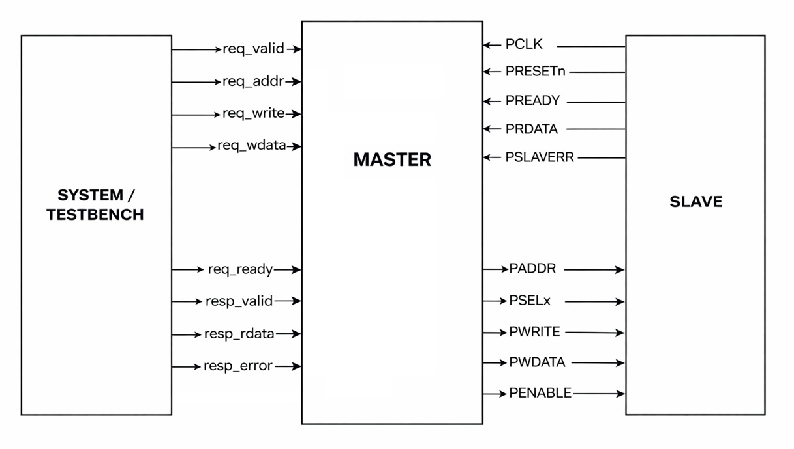

# APB Master–Slave Implementation (Verilog)

## Overview
This project implements a complete APB (Advanced Peripheral Bus) Master and Slave in Verilog, including a system-side request interface and a clock-synchronous testbench.

The design follows the AMBA APB protocol with clear separation between SETUP and ACCESS phases and supports both read and write transactions.

## Block Diagram

The following block diagram illustrates the overall architecture of the APB Master–Slave system, including the system-side interface, APB master FSM, and APB slave connections.

## Features
- FSM-based APB Master (IDLE, SETUP, ACCESS)
- APB Slave with 8 memory-mapped registers
- Correct handling of read (combinational) and write (sequential) operations
- Support for wait states using PREADY
- Clock-synchronous testbench
- Waveform-verified functionality

## Directory Structure
- rtl/ -> Master and Slave RTL
- tb/ -> Testbench
- docs/ -> Design explanation and notes
- waveforms/ -> Simulation screenshots

## How It Works
- The system issues requests using req_valid / req_ready handshake
- The master converts system requests into APB transactions
- The slave decodes addresses and performs register read/write
- Read data is driven combinationally during ACCESS
- Write data is stored synchronously on the clock edge
NOTE: Refer APB notes document in docs/APB_design_notes

## Simulation
- Simulated using Vivado
- Testbench performs:
  - Write to REG2
  - Write to REG5
  - Read back REG2

## Key Learning Outcomes
- FSM-based bus protocol implementation
- Difference between sequential and combinational logic in bus design
- Importance of clock-synchronous testbenches
- Debugging timing and handshake issues using waveforms

## Author
V Sai Charan
